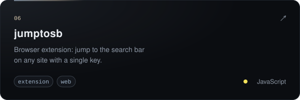

  

<h3 align="center">p0mpurin</h3>

  homebrew &nbsp;·&nbsp; desktop apps &nbsp;·&nbsp; small web things

  
  

 

I make things I want to use myself: homebrew for the Nintendo 3DS, quiet desktop apps,
browser extensions and the occasional website. I like old hardware, simple interfaces
and software that stays out of the way.

 

  
  
  
  
  
  

  
    also &nbsp;
    <a href="https://github.com/p0mpurin/RuneFetch">RuneFetch</a> ·
    <a href="https://github.com/p0mpurin/Nightreign-launcher">Nightreign launcher</a> ·
    <a href="https://github.com/p0mpurin/vitapapers">vitapapers</a> ·
    <a href="https://github.com/p0mpurin/discord-css">discord-css</a> ·
    <a href="https://github.com/p0mpurin/yt_downloader">yt_downloader</a> ·
    <a href="https://github.com/p0mpurin?tab=repositories">everything else</a>
  

 

  

 

  <picture>
    <source media="(prefers-color-scheme: dark)" srcset="https://raw.githubusercontent.com/p0mpurin/p0mpurin/output/snake-dark.svg">
    <source media="(prefers-color-scheme: light)" srcset="https://raw.githubusercontent.com/p0mpurin/p0mpurin/output/snake-light.svg">
    
  </picture>

  

