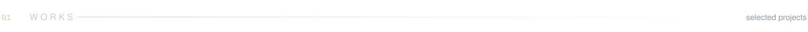
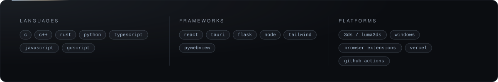

  

  

  

  &nbsp;
  &nbsp;
  

 

  
  
  
  
  
  

  
  
  
  
  

 

  

 

  <picture>
    <source media="(prefers-color-scheme: dark)" srcset="https://raw.githubusercontent.com/p0mpurin/p0mpurin/output/snake-dark.svg">
    <source media="(prefers-color-scheme: light)" srcset="https://raw.githubusercontent.com/p0mpurin/p0mpurin/output/snake-light.svg">
    
  </picture>

 

  

