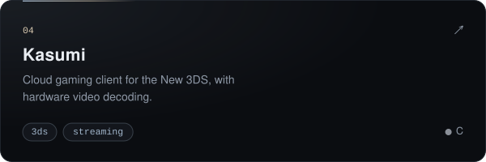
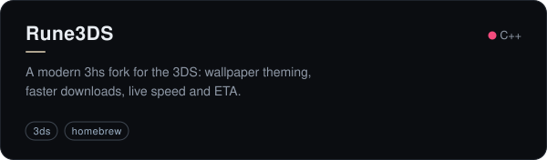
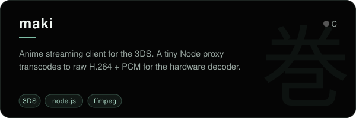
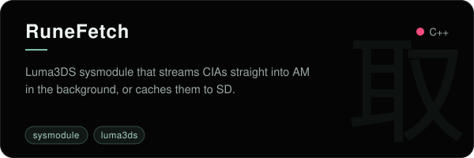
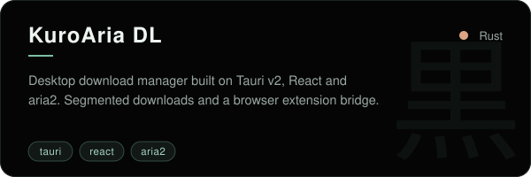
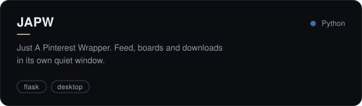

  

  

  
  
  
  

 

### ✦ about

> hi, i'm **p0mpurin**. i write native homebrew for the nintendo 3ds and small desktop apps.
> i like hardware that's a little too old, interfaces that feel quiet, and
> getting a tiny ARM11 to stream games from the cloud.

- ⛩ &nbsp;building **[Kasumi](https://github.com/p0mpurin/Kasumi)**: GeForce NOW, Xbox Cloud and Steam Link on the New 3DS
- ☾ &nbsp;tinkering with **[Rune3DS](https://github.com/p0mpurin/Rune3DS)** and its **[RuneFetch](https://github.com/p0mpurin/RuneFetch)** sysmodule
- ❀ &nbsp;on the side: browser extensions, Tauri apps and little web pages

 

### ✦ projects

  
  
  
  
  
  

 

### ✦ tools i reach for

  

 

### ✦ activity

  <picture>
    <source media="(prefers-color-scheme: dark)" srcset="https://raw.githubusercontent.com/p0mpurin/p0mpurin/output/snake-dark.svg">
    <source media="(prefers-color-scheme: light)" srcset="https://raw.githubusercontent.com/p0mpurin/p0mpurin/output/snake-light.svg">
    
  </picture>

 

  

